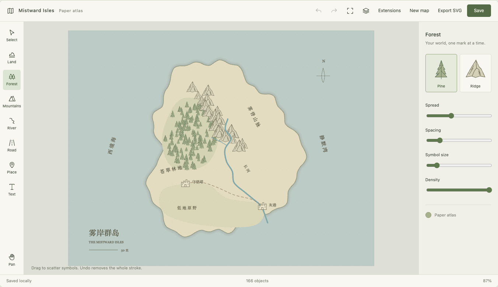
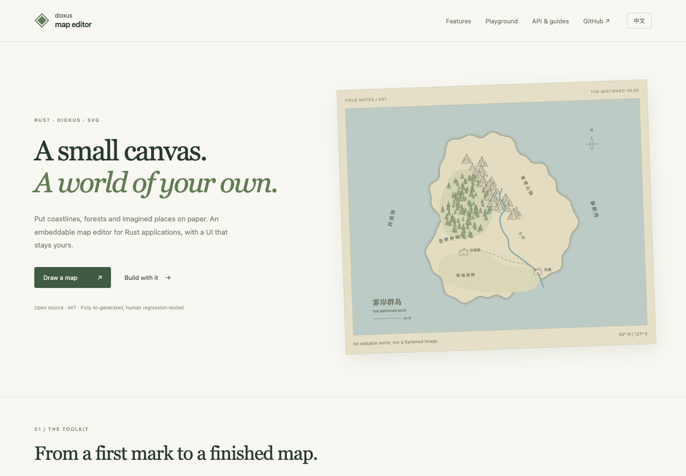

# dioxus-map-editor

[中文](README_ZH.md) · [Website & live demo](https://pk111and222.github.io/dioxus-map-editor/) · [API reference](https://docs.rs/dioxus-map-editor) · [MIT](LICENSE)

An embeddable SVG map editor for **Rust and Dioxus**. Draw paper-style fantasy maps, keep edits in a versioned document, and build your own interface around a controlled canvas.



**This project is fully AI-generated and has undergone human regression testing. If you object to AI-generated software, please do not use it. MR/PR contributions containing AI-generated code are welcome; no AI disclosure label is required.**

## What it does

- Freehand brushes, paths, text, stamps, selection and transforms; layers, styles, undo and redo.
- Drag-to-draw regions/coastlines, textured river/road ribbons, forests, mountains and named places. Release applies a stroke; one undo removes it. Click paths apply each valid node without Finish.
- `MapCanvas` with controlled signals and `MapCanvasHandle`: compose your own divs, toolbar, inspector, overlays and translations. `MapEditor` provides an optional default interface.
- Renderer-independent documents, atomic command batches, bounded history, asynchronous save receipts and host-owned place bindings.
- Optional compiled Rust plugins: JSON/SVG formats, foliage brush, editable compass and an atlas style/symbol pack. Missing-provider payloads survive saving and render recoverable placeholders.
- Versioned JSON and self-contained SVG output. Storage and actual file/network IO belong to the application.

The [live demo](https://pk111and222.github.io/dioxus-map-editor/#playground) is a real editor running locally in your browser. Choose a tool, draw on the paper frame, use Undo/Redo, and click **Save** before refreshing. **Extensions** exposes optional providers, JSON import/export and custom objects. Interface language can change without reopening your map; saved place names and map text remain your content.



## Use with Cargo

Requires **Rust 1.85+** (edition 2021) and **Dioxus 0.7.10**. The initial release is **0.1.0**. See [crates.io](https://crates.io/crates/dioxus-map-editor), [API reference](https://docs.rs/dioxus-map-editor) and the [live website](https://pk111and222.github.io/dioxus-map-editor/).

```toml
[dependencies]
dioxus = { version = "=0.7.10", features = ["web"] }
dioxus-map-editor = { version = "0.1.0", features = ["official-plugins"] }
```

Or add the crate to an existing Dioxus application:

```sh
cargo add dioxus-map-editor@0.1.0 --features official-plugins
```

To use the latest development revision:

```toml
dioxus-map-editor = { git = "https://github.com/pk111and222/dioxus-map-editor", features = ["official-plugins"] }
```

The library's default `ui` feature **does not select a renderer**. Your application enables Dioxus `web` or `desktop`. Core-only applications can use `default-features = false`; all official plugins also work without UI. Runtime dependency ranges are `serde = 1`, `serde_json = 1` (with `float_roundtrip`), and, with UI, `web-time = 1.1` and Dioxus `=0.7.10`. Cargo resolves transitive dependencies; this repository's `Cargo.lock` pins development and website builds.

| Feature | Provides |
| --- | --- |
| `ui` (default) | SVG canvas, optional default editor, host handles |
| `plugin-formats` | Validated JSON import/export and SVG export |
| `plugin-brushes` | Deterministic foliage brush |
| `plugin-objects` | Editable custom compass object |
| `plugin-map` | Atlas style and tree/mountain/place symbols |
| `official-plugins` | All four official providers |

## Embed a canvas

```rust
use dioxus::prelude::*;
use dioxus_map_editor::{
    document::{MapDocument, MapSnapshot},
    editor::EditorTools,
    geometry::Viewport,
    registry::Registry,
    session::MapSession,
    ui::{MapCanvas, MapCanvasHandle},
};

#[component]
fn Editor(invalidation: u64) -> Element {
    let opened = use_hook(|| MapSession::open(
        MapSnapshot::standalone(MapDocument::new("my-map")),
        None, Default::default(), Default::default(),
    ).map(Signal::new));
    let tools = use_signal(EditorTools::default);
    let registry = use_signal(Registry::default);
    let view = use_signal(Viewport::default);
    let mut handle = use_signal(|| None::<MapCanvasHandle>);
    match opened {
        Ok(session) => rsx! {
            button { onclick: move |_| {
                if let Some(canvas) = handle() { canvas.fit_frame(); }
            }, "Fit map" }
            MapCanvas {
                session, tools, registry, view, invalidation,
                show_controls: false, show_status: false,
                onready: move |canvas| handle.set(Some(canvas)),
            }
        },
        Err(error) => rsx! { p { "{error}" } },
    }
}
```

Set a height on the canvas container. Use the handle to access session/tools/registry/view, execute commands, finish paths, cancel gestures, or commit text. `text_overlay` replaces the text editor; `overlay` adds host UI; `TextEditorLabels` translates the default text controls. All built-in strings default to English: `CanvasLabels` translates the canvas view bar, status and accessibility names, and `UiText` (English key → translation) translates the optional `MapEditor`, `EditorToolbar`, `EditorProperties` and `MapTools` panels; untranslated keys stay English.

Theme the components with CSS variables (`--dme-ui-bg`, `--dme-ui-fg`, `--dme-ui-line`, `--dme-ui-accent`, `--dme-canvas-bg`, `--dme-selection` and the other `--dme-*` tokens at the top of `assets/editor.css`) on the component or any ancestor; add `data-dme-theme="dark"` for the bundled dark preset. Selection, handles, frame and snap markers follow the same tokens. Set `--dme-surface-height` (or size `.dme-editor-surface`) to fill a host panel. Pass `inject_css: false` when you load `EDITOR_CSS` once yourself.

`measure` provides renderer-free annotation helpers: a document scale stored as the undoable `dme:scale` extension (`MapScale`), straight-line distance, compass bearing (0° = north, clockwise) and `Compass` sectors, polyline/path/object lengths, and positions of objects or host anchors on the current map. Hosts draw rulers, labels or constraint warnings through `overlay`.

Drawing requires a visible, unlocked layer. The canvas checks this before showing a draft and reports typed failures through `onerror`, even when `show_status` is disabled. Use this callback for your own localized notices. The demo includes an explicit unlock/show action and builds its styled, IME-aware text editor entirely through `text_overlay` and the public handle.

Canvas shortcuts: **Ctrl/Cmd+Z** undo, **Ctrl/Cmd+Shift+Z** redo, hold **Space** and drag to pan, **Ctrl+wheel** to zoom. Unmodified wheel scrolls the page. Text inputs keep native shortcuts and IME behavior. `CanvasInteractionOptions.keyboard_shortcuts` and `ctrl_wheel_zoom` let hosts customize these defaults; `MapCanvasHandle::undo/redo` exposes history for custom controls.

Forest/mountain **Spread** scales the footprint, symbol size and spacing together; **Symbol size** can override size independently. Hosts may use `ScatterSettings::resize` or set those fields separately. Click paths require two points for a line or three for a region, then each point is immediately undoable; Esc/double-click ends the current shape without discarding applied content.

Increment `invalidation` on window focus/visibility changes, ancestor scroll and layout/size changes. See the [browser lifecycle adapter](website/src/lifecycle.rs) and [native launcher](examples/desktop/src/main.rs). `CanvasInteractionOptions` controls frame clipping and pointer re-entry. Native IME inputs must retain their DOM state during composition. Transformed/filter/contain ancestors that alter fixed overlay coordinates are not supported.

Use `session.execute` for edits, `undo`/`redo` for history, and implement `MapStore` for your backend. `flush` handles synchronous saves; asynchronous hosts use `begin_save` → persist → `complete_save`. Save before closing or reloading: the demo does not intercept application exit. Demo storage is localStorage on Web and `~/.dioxus-map-editor-demo` on Desktop (`DME_DEMO_STORE_DIR` overrides it); it is a single-tab/process adapter, not a collaborative backend.

Read the [plugin integration guide](docs/plugins.md), [minimal plugin example](examples/minimal_plugin.rs) and [website API examples](website/src/snippets). Generate the complete API locally with `cargo doc --all-features --no-deps --open`.

Natural region edges, contour snapping and exact shared border arcs are configured through `EditorTools::region`. Trees and mountains share the stamp/scatter pipeline; the demo reads plugin entities from the registry and supports replacing selected symbols. Both the text input and text inspector can be host-owned. See [customization examples](docs/customization.md).

## Run the demos and website

```sh
cargo install dioxus-cli --version 0.7.10 --locked
rustup target add wasm32-unknown-unknown
# Website with bilingual docs and embedded playground:
cd website
dx serve --platform web --port 8080
```

Standalone Web: run `dx serve --platform web --port 8080` from `examples/web`. Desktop: run `cargo run -p map-editor-desktop` from the repository root. Build Web and Desktop packages separately to avoid merging renderer features. macOS requires Xcode Command Line Tools; Windows needs the MSVC toolchain and WebView2. Linux needs GTK 3, WebKitGTK 4.1, ayatana-appindicator, librsvg and patchelf development packages; exact CI packages are in [ci.yml](.github/workflows/ci.yml).

## Static hosting and automatic releases

```sh
# From the repository root; Python 3.9+ is used by release checks.
scripts/build-pages /dioxus-map-editor/
# For a custom domain or root hosting:
scripts/build-pages /
```

Upload **all files in `dist/pages`**, including `.nojekyll`, to a static host serving the selected base path. No Rust server or Node runtime is required. Preview with an HTTP server, not `file://` (Wasm module loading requires HTTP). The project builds all website UI and application behavior in Rust/Dioxus; JavaScript emitted by the toolchain loads the Wasm application.

[Website and crate release](.github/workflows/publish.yml) runs on **every push to `main`**, including merges from any branch, after CI passes:

1. Build and deploy the bilingual website to GitHub Pages. In repository **Settings → Pages → Build and deployment**, choose **GitHub Actions**. The build uses the actual Pages base path, including custom domains.
2. Compare the root `Cargo.toml` package version before/after the push. Unchanged versions skip crates.io. A version bump publishes with **`CARGO_REGISTRY_TOKEN`**; the first Cargo initialization also counts as a change. Downgrades fail. Already published versions (including yanked versions) skip safely on retries.

Change `package.version` deliberately and update `Cargo.lock` before merging a release. There is no automatic version bump. Manual workflow dispatch from `main` redeploys Pages only. The token must have permission to publish `dioxus-map-editor`; it is read only in the publication step. Publishing and deployment run from the pushed commit. See [CONTRIBUTING.md](CONTRIBUTING.md) for local checks.

## Scope and testing

Human regression testing has covered macOS IME text entry, fast drawing, frame clipping, leave/re-enter gestures, and save/reopen. Automated tests cover document validation, history/storage, interaction state, map tools and plugins. Windows/Linux device testing and native quantitative performance remain pending.

Terrain union/erasing and manually controlled river width profiles are not implemented. River brushes taper from source to mouth. SVG is export-only; arbitrary SVG import, PNG/PDF output, pressure input and dynamic/untrusted plugin loading are outside the current API. Assets are original vector artwork; see [THIRD_PARTY.md](THIRD_PARTY.md). Contributions follow [CONTRIBUTING.md](CONTRIBUTING.md).
