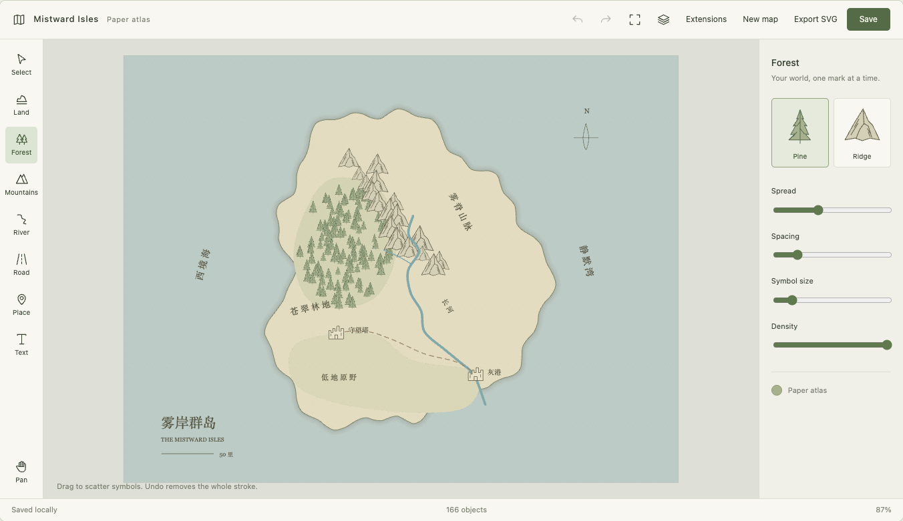
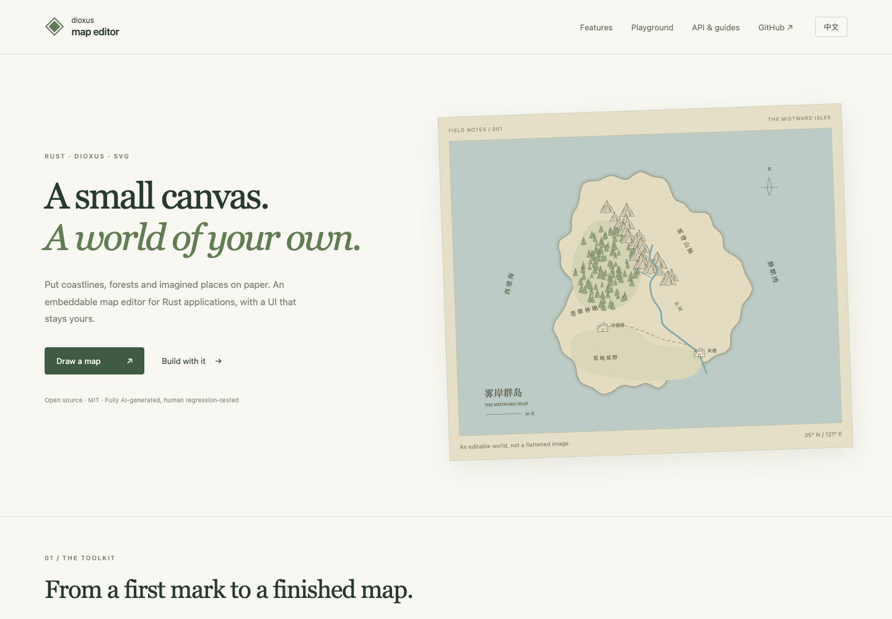

# dioxus-map-editor

[English](README.md) · [官网与在线体验](https://pk111and222.github.io/dioxus-map-editor/) · [API 文档](https://docs.rs/dioxus-map-editor) · [MIT](LICENSE)

面向 **Rust 与 Dioxus** 的可嵌入 SVG 地图编辑器。绘制纸面幻想地图，以版本化文档保存编辑，并围绕受控画布构建自己的界面。



**本项目全部由 AI 生成，已进行人工回归测试。如果你对此有意见，请勿使用。接受 AI 生成代码的 MR / PR，无需额外标注 AI 来源。**

## 功能与体验

- 自由笔刷、路径、文字、图章、选择与变换，以及图层、风格、撤销重做。
- 地图模式：拖绘区域与海岸、带纹理的河流/道路带状区域、森林、山脉、命名地点。松手生效，一次撤销整笔；点击路径在节点数有效后逐点生效，无需 Finish。
- `MapCanvas` 接受受控 signal，`MapCanvasHandle` 暴露操作接口；工具栏、属性面板、覆盖层与国际化都可用自己的 div 实现。`MapEditor` 提供可选默认界面。
- 与渲染器无关的文档、原子命令批次、有限历史、异步保存回执与宿主地点绑定。
- 可选 Rust 编译期插件：JSON/SVG 格式、植被画笔、可编辑罗盘、地图风格与图章包。缺失插件时保留载荷并显示可恢复占位。
- 版本化 JSON、自包含 SVG 导出；存储后端及文件/网络 IO 由宿主决定。

[在线体验](https://pk111and222.github.io/dioxus-map-editor/#playground) 在浏览器本地运行真实编辑器。选择工具后在纸面画框内绘制，使用撤销/重做，刷新前点击**保存**。**扩展**中可切换官方插件、导入导出 JSON、添加自定义对象。界面切换中英文不会重新打开地图；已有地图文字与地点名称属于内容，不自动翻译。



## Cargo 接入

需要 **Rust 1.85+**（edition 2021）、**Dioxus 0.7.10**。首个版本为 **0.1.0**，可访问 [crates.io](https://crates.io/crates/dioxus-map-editor)、[API 文档](https://docs.rs/dioxus-map-editor) 与[在线官网](https://pk111and222.github.io/dioxus-map-editor/)。

```toml
[dependencies]
dioxus = { version = "=0.7.10", features = ["web"] }
dioxus-map-editor = { version = "0.1.0", features = ["official-plugins"] }
```

已有 Dioxus 应用也可以运行：

```sh
cargo add dioxus-map-editor@0.1.0 --features official-plugins
```

使用最新开发版本：

```toml
dioxus-map-editor = { git = "https://github.com/pk111and222/dioxus-map-editor", features = ["official-plugins"] }
```

库默认启用 `ui`，由应用选择 Dioxus `web` 或 `desktop` 渲染器。纯数据场景可设置 `default-features = false`；官方插件也支持无 UI 使用。直接依赖范围为 `serde = 1`、`serde_json = 1`（启用 `float_roundtrip`）；UI 另需 `web-time = 1.1` 和 Dioxus `=0.7.10`。传递依赖由 Cargo 解析，本仓库用 `Cargo.lock` 固定开发与官网构建版本。

| Feature | 能力 |
| --- | --- |
| `ui`（默认） | SVG 画布、可选默认编辑器、宿主 handle |
| `plugin-formats` | 校验后的 JSON 导入导出、SVG 导出 |
| `plugin-brushes` | 确定性植被笔刷 |
| `plugin-objects` | 可编辑自定义罗盘对象 |
| `plugin-map` | 地图风格、树木/山峰/地点图章 |
| `official-plugins` | 以上四个官方插件 |

## 嵌入画布

```rust
use dioxus::prelude::*;
use dioxus_map_editor::{
    document::{MapDocument, MapSnapshot},
    editor::EditorTools,
    geometry::Viewport,
    registry::Registry,
    session::MapSession,
    ui::{MapCanvas, MapCanvasHandle},
};

#[component]
fn Editor(invalidation: u64) -> Element {
    let opened = use_hook(|| MapSession::open(
        MapSnapshot::standalone(MapDocument::new("my-map")),
        None, Default::default(), Default::default(),
    ).map(Signal::new));
    let tools = use_signal(EditorTools::default);
    let registry = use_signal(Registry::default);
    let view = use_signal(Viewport::default);
    let mut handle = use_signal(|| None::<MapCanvasHandle>);
    match opened {
        Ok(session) => rsx! {
            button { onclick: move |_| {
                if let Some(canvas) = handle() { canvas.fit_frame(); }
            }, "适应画布" }
            MapCanvas {
                session, tools, registry, view, invalidation,
                show_controls: false, show_status: false,
                onready: move |canvas| handle.set(Some(canvas)),
            }
        },
        Err(error) => rsx! { p { "{error}" } },
    }
}
```

为画布容器设置高度。handle 可访问 session/tools/registry/view、提交命令、结束路径、取消手势或提交文字。`text_overlay` 替换文字编辑层，`overlay` 增加宿主 UI，`TextEditorLabels` 自定义默认文字按钮。可选 `MapEditor` 的默认工具栏目前是中文；完整国际化界面请像 demo 一样组合 `MapCanvas`。

绘制要求当前图层可见且未锁定。画布会在显示草稿前检查，并通过 `onerror` 返回类型化错误，即使关闭 `show_status` 也能接收，方便宿主实现自己的多语言提示。demo 提供明确的解锁/显示操作，并完全通过 `text_overlay` 和公开 handle 实现支持输入法组合输入的纸面风格文字编辑器。

画布快捷键：**Ctrl/Cmd+Z** 撤销，**Ctrl/Cmd+Shift+Z** 重做，按住**空格**拖动平移，**Ctrl+滚轮**缩放。普通滚轮滚动页面。文字输入框保留原生快捷键与输入法行为。宿主可用 `CanvasInteractionOptions.keyboard_shortcuts`、`ctrl_wheel_zoom` 调整默认策略，通过 `MapCanvasHandle::undo/redo` 对接自定义控件。

山林的“笔刷范围”会联动范围、图章大小与间距，“图章大小”可独立覆盖尺寸。宿主可调用 `ScatterSettings::resize` 或分别设置字段。点击路径需要两个点形成线段、三个点形成区域，之后每个节点立即生效并可撤销；Esc/双击结束当前形状，已提交内容保留。

窗口焦点/可见性变化、祖先滚动、布局与尺寸变化时递增 `invalidation`，接法见[浏览器适配](website/src/lifecycle.rs)和[桌面启动器](examples/desktop/src/main.rs)。`CanvasInteractionOptions` 控制画框裁剪与按住指针离开后重入。输入法组合期间需保留原生输入框状态。暂不支持会改变固定覆盖层坐标系的祖先 CSS transform/filter/contain。

编辑使用 `session.execute`，历史使用 `undo`/`redo`。实现 `MapStore` 对接后端；同步保存用 `flush`，异步用 `begin_save` → 实际持久化 → `complete_save`。关闭或刷新前请先保存，demo 不接管退出。Web 数据在 localStorage，Desktop 在 `~/.dioxus-map-editor-demo`，可用 `DME_DEMO_STORE_DIR` 覆盖；示例适配器限定单标签页/单进程，不提供协同编辑。

更多内容见[插件指南（英文）](docs/plugins.md)、[最小插件](examples/minimal_plugin.rs)与[官网 API 示例](website/src/snippets)。完整 API 可通过 `cargo doc --all-features --no-deps --open` 在本地生成。

区域支持自然边缘、轮廓吸附和精确共边，通过 `EditorTools::region` 配置。树木和山脉共用图章散布逻辑；demo 从注册表读取插件实体，并可替换选中的图章。文本输入层和文字属性面板均可由宿主定制，参见[定制示例](docs/customization.md)。

## 运行官网与示例

```sh
cargo install dioxus-cli --version 0.7.10 --locked
rustup target add wasm32-unknown-unknown
# 双语官网与真实在线编辑器
cd website
dx serve --platform web --port 8080
```

独立 Web 示例：在 `examples/web` 运行 `dx serve --platform web --port 8080`。桌面示例：在仓库根运行 `cargo run -p map-editor-desktop`。Web 与 Desktop 请分包构建，避免渲染器 feature 合并。macOS 需要 Xcode Command Line Tools，Windows 需要 MSVC 与 WebView2；Linux 需要 GTK 3、WebKitGTK 4.1、ayatana-appindicator、librsvg 和 patchelf 开发包，准确包名见 [CI](.github/workflows/ci.yml)。

## 静态资源与自动发布

```sh
# 在仓库根运行；发布检查脚本需要 Python 3.9+
scripts/build-pages /dioxus-map-editor/
# 自定义域名或根路径托管
scripts/build-pages /
```

将 **`dist/pages` 内全部内容**（含 `.nojekyll`）部署到对应路径即可，无需 Rust 服务端或 Node 运行时。请使用 HTTP 服务器预览，`file://` 无法正常加载 Wasm 模块。官网 UI 和应用逻辑全部用 Rust/Dioxus 编写，工具链生成的 JavaScript 负责加载 Wasm。

[发布工作流](.github/workflows/publish.yml)在**每次推送 main** 时运行，包括任意分支合并后的 main 推送；必须先通过 CI：

1. 构建并部署 GitHub Pages。仓库 **Settings → Pages → Build and deployment** 选择 **GitHub Actions**。构建自动使用实际 Pages 路径，兼容自定义域名。
2. 对比推送前后根 `Cargo.toml` 的包版本。版本不变只部署官网；版本升级时使用 **`CARGO_REGISTRY_TOKEN`** 发布 crates.io。首次引入 Cargo 包也视为版本变化；降级拒绝发布；重试时已发布版本（含 yanked）安全跳过。

发布前主动修改 `package.version` 并更新 `Cargo.lock`，脚本不自动增加版本号。手动从 main 触发工作流只重新部署官网。密钥需具有 `dioxus-map-editor` 发布权限，仅发布步骤读取。这些配置在推送 GitHub 后生效，编写配置本身不会完成线上部署。开发检查见 [CONTRIBUTING.md](CONTRIBUTING.md)。

## 当前范围与验证

已有 macOS 人工回归覆盖中文输入法、快速绘制、画框边界、离开后返回续画，以及保存重开。自动化测试覆盖文档校验、历史与存储、交互状态、地图工具与插件。Windows/Linux 真机验证和原生定量性能仍待完成。

尚未实现地形合并/擦除、手动控制河流宽度曲线；河流笔刷会从源头到河口逐渐变宽。SVG 目前仅导出；任意 SVG 导入、PNG/PDF 导出、压感和动态/不可信插件加载不在当前 API 范围内。素材为原创矢量，见 [THIRD_PARTY.md](THIRD_PARTY.md)；贡献请遵循 [CONTRIBUTING.md](CONTRIBUTING.md)。
